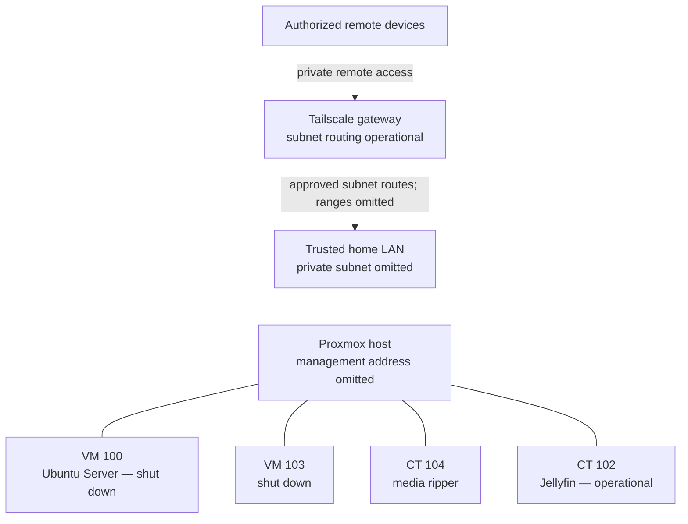

# Home Lab | Proxmox, Pi-hole, Jellyfin & Media Storage

> Personal home server and cybersecurity learning lab. This repository documents architecture, operating procedures, configuration decisions, troubleshooting, and future improvements. Public documentation uses placeholders for private-network data; keep exact home IPs, routes, hostnames, and credentials in private notes.

## Overview

This homelab uses a Dell OptiPlex 7040 running Proxmox VE to host virtual machines and network services. Current reported workloads include Jellyfin and a media-ripping container, with Tailscale providing private remote access and subnet routing. Exact local addressing and route prefixes are intentionally omitted from this public repository.

## Latest Verified Infrastructure Updates — November 4, 2026

### Proxmox guests and services

| Guest | Current role / status |
| --- | --- |
| VM 100 | Ubuntu Server; shut down. Do not describe it as an active Pi-hole server. |
| VM 103 | Shut down; no active workload reported. |
| CT 104 | Media ripper. |
| CT 102 | Jellyfin media server; operational. |
| Tailscale gateway | Operational. |

### Hardware

- No RAM upgrade has been installed.
- No SSD/NVMe upgrade has been installed.
- The existing hardware configuration remains in use.

### Tailscale and remote access

- Tailscale subnet routing is reported operational.
- Proxmox and other home-server services are reported accessible remotely through Tailscale.
- Advertised subnet routes are reported approved.
- No route CIDRs, keys, auth tokens, or device-specific access details are published here. Keep access narrowly scoped and do not expose management services through public port forwarding.

## Network architecture (logical, redacted)

This is a diagram of the current network stack within the home server

## Hardware inventory

| Equipment | Role | Status |
| --- | --- | --- |
| Dell OptiPlex 7040 | Proxmox host | Existing configuration remains in use |
| Raspberry Pi | Previously documented DNS device | Current role/status not re-verified in latest update |
| ISP router and local network equipment | Gateway / LAN | Exact model, addresses, and configuration kept private |

No RAM or SSD/NVMe upgrade has been installed, November 4, 2026 update.

## Documentation index

- [Hardware and network inventory](docs/inventory.md)
- [Service runbook](docs/runbook.md)
- [Backup and restore plan](docs/backups.md)
- [Change log](docs/changelog.md)
