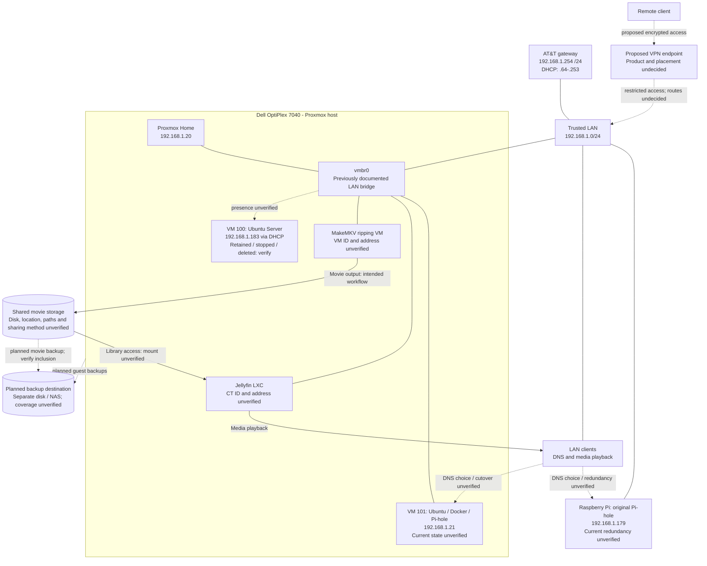

# Home Lab | Proxmox, Pi-hole, Jellyfin & Media Storage

> Personal home server and cybersecurity learning lab. This repository documents architecture, operating procedures, configuration decisions, troubleshooting, and future improvements.

## Overview

This homelab uses a Dell OptiPlex 7040 running Proxmox VE to host Linux virtual machines and network services. The initial production-like workload is a dedicated Pi-hole DNS VM, alongside an existing Raspberry Pi Pi-hole instance during migration/testing. The goal is to learn virtualization, Linux administration, DNS, networking, backup/recovery, and eventually security segmentation.

**Current phase:** DNS and media homelab, with backup, hardware-upgrade, and VPN planning. See the dated update below. Original setup notes and completion checkboxes are retained as historical records, not fresh verification.

## Network architecture



**Legend:** Solid lines show documented logical membership or owner-reported media roles; they do not certify live configuration. Dotted arrows mark proposed or unverified relationships. Arrows labeled movie output, library access, or playback show data flow, not physical cables. The shared storage and VPN endpoint are outside the host group because their physical placement is unverified.

**Verification limits:** All addresses and `vmbr0` are retained from earlier records. Guest bridge attachment, current service health, DNS selection, media mounts, and permissions require checking. MakeMKV is not assumed to be VM 100. VPN access and separate-disk backups are plans, not deployed services. Keep both Pi-holes reachable before changing household DNS settings, and do not expose management or DNS ports directly to the public internet.

## Current homelab — 2026-10-28

The owner reports Pi-hole, a Jellyfin LXC, a MakeMKV media-ripping VM, and shared movie storage on the Proxmox homelab. No live host or guest configuration was inspected for this update. Earlier IPs, versions, and hardware figures are historical. Earlier migration checklists disagree on Teleporter completion; current migration and household DNS cutover remain unverified.

| Component | Role / status | Unverified details |
| --- | --- | --- |
| Pi-hole | DNS filtering; previously documented in VM 101 with Docker and on Raspberry Pi | Current health, migration parity, client DNS selection, backup coverage, autostart, and Raspberry Pi redundancy |
| Jellyfin LXC | Owner-reported movie-library service | CT ID, address, OS/version, resources, privilege mode, startup order, mounts, UID/GID mapping, hardware acceleration |
| MakeMKV VM | Owner-reported media-ripping service | VM ID, address, OS/version, resources, optical-drive attachment, output path; do not assume this is VM 100 |
| Shared movie storage | Owner-reported shared library for ripping and playback | Physical disk, capacity, filesystem, free space, host/guest paths, sharing method, permissions, backup inclusion |
| SSD / RAM upgrades | Planned improvements | Compatibility, target capacities, purchase/install status, migration method |
| VPN access | Proposed private remote access | Product, endpoint, routes, DNS, authentication, allowed services, deployment status; not claimed active |

### Media workflow

MakeMKV VM → shared movie storage → Jellyfin LXC → playback clients.

This is a logical workflow, not a verified mount or network diagram. Verify the ripping output and Jellyfin library reach the same dataset. Proposed practice: stage incomplete rips separately, check completed files, then publish them to the library. Where practical, allow MakeMKV to write movies and Jellyfin to read them; keep Jellyfin's writable configuration, metadata, and cache separate. Actual permissions remain unverified.

### Hardware and remote-access plans

- Verify SSD form factor/interface, connections, capacity, and storage layout before selecting or migrating host/active guest disks. The existing HDD role remains historical until rechecked.
- Verify installed RAM modules, supported capacity, free slots, and guest demand before selecting an upgrade. No new installed capacity is claimed.
- Validate recoverable backups before hardware work; test guest boot, DNS, mounts, ripping, and playback afterward.
- Evaluate VPN access with only required services reachable. Provider, endpoint, port requirements, split/full-tunnel routing, and remote DNS behavior remain undecided.
- Keep management and DNS services off public port forwards as described above. Keep VPN keys, enrollment tokens, client profiles, and recovery material private.

See the [inventory](docs/inventory.md), [runbook](docs/runbook.md), and [backup plan](docs/backups.md) for verification and recovery tasks.

## Hardware inventory

| Equipment | Role | Known details | Status |
| --- | --- | --- | --- |
| Dell OptiPlex 7040 | Proxmox host | ~8 GB RAM; ~1.8 TB HDD | Running |
| Raspberry Pi | Original Pi-hole | Existing DNS installation | Operational per last check |
| AT&T gateway | Main router / DHCP | `192.168.1.254`, `/24` | Active |

## IP address inventory

| System | IPv4 | Assignment / Notes |
| --- | --- | --- |
| Gateway | `192.168.1.254` | Confirmed |
| Proxmox node `Home` | `192.168.1.20` | Static, confirmed |
| Raspberry Pi Pi-hole | `192.168.1.179` | Within DHCP pool; reserve if continuing as DNS |
| VM 101 / new Pi-hole | `192.168.1.21` | Outside DHCP pool; static, confirmed |
| VM 100 / Ubuntu | `192.168.1.183` | DHCP at last check; VM may be shut down or deleted |

- Subnet: `192.168.1.0/24` (`255.255.255.0`)
- Gateway DHCP pool: `192.168.1.64–192.168.1.253`
- Static address candidate space: `.1–.63`, subject to checking for conflicts
- **Never assume** a planned address is unoccupied without checking.

## Software & services

| Component | Location | State / notes |
| --- | --- | --- |
| Proxmox VE 9.2.2 | Dell OptiPlex | Hypervisor; `https://192.168.1.20:8006` from trusted LAN |
| Ubuntu Server | VM 101 | Pi-hole guest OS |
| Docker Engine + Compose | VM 101 | Runs Pi-hole container |
| Pi-hole | VM 101 | Dashboard reachable at `http://192.168.1.21/admin/`; container previously healthy |
| Original Pi-hole | Raspberry Pi | `http://192.168.1.179/admin/`; retain during migration |
| Ubuntu Server | VM 100 | General learning VM; status to verify before documenting as removed |

## Network design and security

- `vmbr0` bridges the physical Ethernet interface to trusted VMs on the AT&T LAN.
- Do **not** connect intentionally vulnerable lab machines to this family LAN; isolate them before offensive/security testing.
- Do **not** forward Proxmox management (`8006`), SSH (`22`), Pi-hole admin (`80`), or DNS (`53`) to the public internet.
- Use strong unique credentials and Proxmox TOTP 2FA with recovery codes kept offline.
- Keep the gateway's DHCP service enabled until a tested DHCP migration plan exists.
- Pi-hole on Proxmox goes offline when the host is rebooted. The Raspberry Pi can provide independent DNS redundancy, but DNS clients may use either advertised DNS server; keep policies synchronized.

## Deployment and operations

- [x] Install Proxmox VE on OptiPlex
- [x] Configure host LAN IP (`192.168.1.20`)
- [x] Create Pi-hole VM 101 (`192.168.1.21`)
- [x] Install Docker / Pi-hole and confirm dashboard access
- [x] Confirm Teleporter settings import and list parity on both instances
- [x] Confirm DNS and blocking tests on both instances
- [x] Confirm household DNS/DHCP approach and perform controlled cutover, if desired
- [x] Verify Proxmox VM 101 autostart and Docker restart behavior
- [ ] Configure backups to a **separate physical disk**, and test a restore
- [ ] Verify whether VM 100 is still present, stopped, or deleted
- [ ] Decide whether to add SSD and more RAM
- [ ] Plan isolated VLAN/lab network before integrating additional routers/switches

## Quick verification commands

```bash
# Proxmox HOST shell
pveversion
ip -br addr
ip route
qm list
qm agent 101 ping   # only if guest agent is configured
```

```bash
# Inside Ubuntu VM 101
ip -br addr
cd /opt/pihole
sudo docker compose ps
sudo docker compose logs --tail=50
```

```powershell
# Windows PowerShell on trusted LAN
nslookup google.com 192.168.1.21
nslookup google.com 192.168.1.179
Test-NetConnection 192.168.1.21 -Port 80
```

## Documentation index

- [Hardware and network inventory](docs/inventory.md)
- [Service runbook](docs/runbook.md)
- [Backup and restore plan](docs/backups.md)
- [Change log](docs/changelog.md)

## Future roadmap

1. Reliable DNS failover and configuration synchronization.
2. VM backups and restore drills; external storage.
3. SSD for host/active VMs and possible RAM upgrade.
4. Dedicated Docker applications (e.g., uptime monitoring or media services).
5. Network segmentation using the managed switch/router only after designing isolation rules.

## Public repository safety

This repository contains example private LAN IP addresses and device roles. Consider replacing these with placeholders if publishing your exact home topology. **Never commit:** passwords, TOTP secrets/recovery codes, `.env` files, SSH keys, API tokens, router configuration backups, Teleporter backup archives, or personal host identifiers you wish to keep private.

## License

Documentation is for personal educational use. Add a license if you intend to permit reuse.
